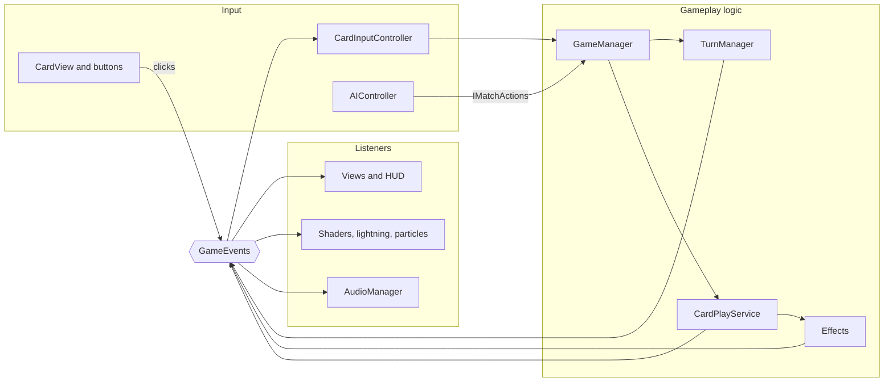
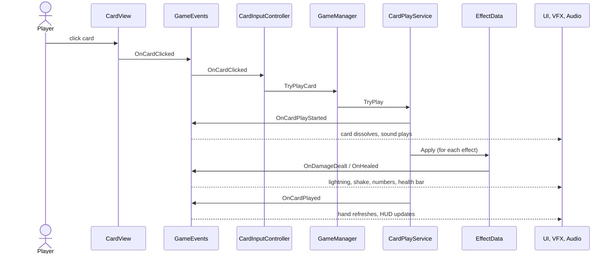

# Science Clash

**A 1v1 card battler where famous scientists fight with their signature cards.**
Pick one of six scientists, spend energy to play cards, and bring the computer's scientist to zero health before it does the same to you.

Built in Unity 6 (2D, URP) as the final coding challenge: a small game with a focus on **clean architecture** and **polish** (shaders, particles, juice and sound).

## Demo

[▶ Watch the gameplay video](ADD-VIDEO-LINK-HERE)

<!-- Add 2-3 screenshots or a GIF here, for example:


-->

## Contents

- [How to play](#how-to-play)
- [The scientists](#the-scientists)
- [Card effects](#card-effects)
- [Visual and audio polish](#visual-and-audio-polish)
- [Architecture](#architecture)
- [Challenge brief checklist](#challenge-brief-checklist)
- [Getting started](#getting-started)
- [Development process](#development-process)
- [Credits](#credits)

---

## How to play

1. Press **PLAY** on the title screen.
2. **Choose your scientist.** Each of the six has 30 HP and a unique set of 6 signature cards.
3. On your turn, **click a card** to play it. Cards cost energy, shown in the top-left corner of the card.
4. Click **END TURN** when you're done (or out of energy). The computer then plays its turn.
5. Win by bringing the enemy scientist to 0 HP.

| Input | Action |
|---|---|
| Mouse hover on a card | Holographic foil and tilt |
| Left click on a card | Play the card |
| End Turn button | Pass the turn to the computer |
| Esc | Pause menu (resume / restart / quit) |

## The scientists

| Scientist | Style |
|---|---|
| Curie | Radiation and sustain (life-steal and healing) |
| Newton | Heavy, reliable damage |
| Tesla | Electric multi-hits and risky big hits |
| Turing | Finishers that punish low-health targets |
| Lovelace | Algorithmic multi-hits and healing |
| Einstein | High risk, high reward (big damage with recoil) |

Each scientist has a signature accent color that tints their cards, hit effects and lightning.

## Card effects

| Effect | What it does |
|---|---|
| Damage | Deals a fixed amount of damage |
| Heal | Restores health to yourself |
| Life Steal | Deals damage and heals you for the same amount |
| Multi Hit | Several separate hits (each one triggers its own hit feedback) |
| Overcharge | Big damage, but you take recoil damage (recoil can never kill you) |
| Execute | Bonus damage if the target is below a health threshold |

36 signature cards in total (6 per scientist). A card can combine several effects, for example *Alternating Current* = Damage + Multi Hit.

---

## Visual and audio polish

### Art direction

A "dark lab terminal" look: deep navy surfaces with glowing cyan and amber accents. Every color lives in one `UiPalette` asset, and UI, shaders and effects read from it instead of hardcoding colors.

| Role | Hex |
|---|---|
| Background | `#0B1220` |
| Panel | `#131C2E` |
| Primary (cyan) | `#3DD9FF` |
| Secondary (amber) | `#FFB347` |
| Damage | `#FF4D6D` |
| Heal | `#5CFFA8` |
| Text | `#E8F1FF` |

Fonts: **Chakra Petch** for text and titles, **Electronic Highway Sign** for button labels.

### Shaders

- **Animated background** (`BackgroundFX`): a moving, living lab backdrop.
- **Card dissolve** (`Dissolve`): played cards and defeated scientists burn away with an edge in the scientist's accent color.
- **Holographic card foil** (`Holo`): a rainbow sheen follows the cursor on a hovered card, tinted with the scientist's accent color, and the card tilts toward the mouse.
- **Chromatic aberration** (`BackgroundAberration`): a short color-split flash when something is hit.
- **Lightning** (`Lightning`): a glowing, crackling bolt jumps from the attacker's portrait to the target's whenever damage is dealt. It is tinted with the attacker's accent color, and multi-hit cards fire one bolt per hit. Big hits (10 damage or more) get a thicker bolt and a white screen flash like a thunderclap. Recoil damage (hurting yourself) gets no bolt.
- **Duotone** (`UIDuotone`): gives the background and portraits a consistent color identity.
- **Selection glow** on the scientist selection screen.

### Particles

- A custom UI particle system for ambient dust, hit bursts and the game over celebration.

### Juice

- Screen shake on hits.
- Floating damage and heal numbers.
- Health bar that slides smoothly and changes from green to red, plus a portrait flash (red for damage, green for healing).
- Buttons grow on hover and shrink when pressed.
- Cards pop in when drawn; HUD text pops when it changes.
- Game over screen fades in with a bouncing result text.

### Audio

Music, plus sound effects for buttons, drawing and playing cards, turn start, hits, heals, lightning zaps, victory and defeat. Everything is played by one `AudioManager` that listens to game events.

---

## Architecture

The project is **event-driven**: systems never reference each other directly. They raise or listen to events in one place (`GameEvents`), so UI, audio and effects can all react to the game without the game logic knowing they exist.

### Project layout

```
Agent.md                 Rules for humans and AI agents (git workflow, architecture rules)
.claude/skills/          Project skills (add-game-event, add-scientist-ability, port-shadertoy-shader)
Assets/
├── Scripts
│   ├── Core        GameEvents (single owner of every event), ICombatant, EffectContext
│   ├── Data        ScriptableObjects: CardData, ScientistData, UiPalette
│   ├── Effects     One ScriptableObject per card effect (Damage, Heal, LifeSteal, MultiHit, Overcharge, Execute)
│   ├── Gameplay    Pure game logic: GameManager, TurnManager, CardPlayService, Deck, Hand,
│   │               PlayerState, Scientist, WinChecker, MatchSetup, AIStrategy, AIController
│   ├── UI          Views and visual feedback (HandView, CardView, ScientistPanelView, TurnHUDView,
│   │               shader controllers, lightning, particles, pause / title / game over screens)
│   ├── Audio       AudioManager (listens to GameEvents, plays music and sound effects)
│   └── Editor      Tools that generate content and assign assets (roster, card icons, art materials)
├── Shaders         Custom UI shaders
└── Data            Generated effect and card assets, palette
```

### How the pieces talk



### What happens when you play a card



### Key design decisions

- **One owner for events.** Every event is declared in `GameEvents`. No other class declares static events, which keeps the flow of the game easy to trace.
- **Data-driven content.** Cards, scientists and effects are ScriptableObjects. Adding a card means creating an asset, not writing code.
- **Effect system.** Each card holds a list of `EffectData` assets. A new effect is one small class; cards can combine several effects.
- **Logic separated from presentation.** Gameplay classes know nothing about the UI. Views only read state and listen to events.
- **Small, focused sub-systems.** Match setup, turn flow, card playing, win checking and AI each live in their own class (`MatchSetup`, `TurnManager`, `CardPlayService`, `WinChecker`, `AIStrategy`).
- **AI split in two.** `AIStrategy` is pure logic (decides *what* to play); `AIController` only handles timing (decides *when*) and acts through the `IMatchActions` interface.
- **Reusable juice components.** `UiPunch`, `ButtonJuice`, `FloatingNumber`, `UiDissolve`, `LightningBolt` and `ScreenFlash` are small, self-contained and created by script, so no prefab editing is required.
- **Effects listen, they don't drive.** For example, `LightningController` only listens to damage events to decide where to draw a bolt. The game logic knows nothing about it.
- **Single source of truth for colors.** `UiPalette` feeds the UI, shaders and effects.
- **Editor tooling.** `Science Clash > Generate Roster Content` rebuilds all effect and card assets from one script, which keeps balance changes in one place.

---

## Challenge brief checklist

| Requirement | Where to see it |
|---|---|
| Unity 6 or newer | Unity 6 project, URP (2D) |
| Skills set up | [`.claude/skills/`](.claude/skills) |
| `Agent.md` with GitHub rules | [`Agent.md`](Agent.md) |
| One feature at a time | Branch-per-feature history in the commit log |
| Shaders and particles | [Visual and audio polish](#visual-and-audio-polish) |
| Good architecture | [Architecture](#architecture) |
| Not "AI slop" | One art direction, a single palette, and custom shaders and effects on top of the art |
| Public GitHub repository | This repository |
| Brief screen recording | [Demo](#demo) |

---

## Getting started

**Requirements:** Unity 6 or newer, with the Universal Render Pipeline (included in the project).

1. Clone the repository:
   ```bash
   git clone https://github.com/YOUR-USERNAME/YOUR-REPO.git
   ```
2. Open the project folder in **Unity Hub**. The first import takes a few minutes.
3. Open `Assets/Scenes/SampleScene.unity`.
4. Press **Play**.

**Editor tools** (menu **Science Clash**):

- **Generate Roster Content:** rebuilds all effect and card assets and assigns them to the six scientists. It overwrites the generated assets, so change balance numbers in this script, not by hand.
- **Assign Card Icons:** gives every card an icon from `Assets/Art/CardIcons` (a file named after the card, or the icon of its main effect type).

---

## Development process

The project follows the rules in [`Agent.md`](Agent.md):

- One feature per branch (`feat/...`, `fix/...`), merged into `main` when it works.
- Small commits with a prefix (`feat:`, `fix:`, `balance:`).
- Features were built one at a time, planned first, then tested before moving on.
- Repeatable tasks have a skill in `.claude/skills/`: adding a game event, adding a scientist or ability, and porting a Shadertoy shader to Unity.

**Roadmap followed:** repo and setup, event manager and sub-system split, effect system, abilities and 36 cards, game flow (title and pause), visual identity, art, animated background, dissolve, holographic card, selection glow, hit feedback, particles, juice and sound, bug and balance pass, and a final lightning effect.

**Use of AI:** built with AI assistance (Claude) for planning, code and shader conversion. Testing, integration and design decisions were done by me.

### Balance

A rough simulation of AI-vs-AI matches was used to find outliers. It showed Curie winning far too often because of her life-steal cards and Turing winning too rarely, so their numbers were adjusted. This was a sanity check, not a guarantee: real play testing matters more.

### Possible future work

- A smarter AI: take lethal damage when available, and avoid recoil cards when low on health.
- Volume sliders in the pause menu.
- More scientists and cards.

---

## Credits

**Fonts**
- [Chakra Petch](https://fonts.google.com/specimen/Chakra+Petch), SIL Open Font License.
- Electronic Highway Sign (add the author, source link and license here).

**Sound effects**
- From [Mixkit](https://mixkit.co/) (Mixkit Sound Effects Free License): "Ethereal fairy win sound", "Heal soft water spell", "Impact of a strong punch", "Player losing or failing".
- Add the source and license of the remaining sound effects and the music here.

**Card icons**
- [game-icons.net](https://game-icons.net) (add each icon's author and the license).

**AI-generated art**
- Scientist portraits and the lab background were generated with Gemini (Google), then restyled in the engine with custom shaders.

**Shaders**
- Custom shaders written for this project, with some adapted from Shadertoy. Add each adapted shader here: title, author and link.

**Tools**
- Unity, TextMeshPro, Universal Render Pipeline (2D), Claude (Anthropic) for AI assistance.
